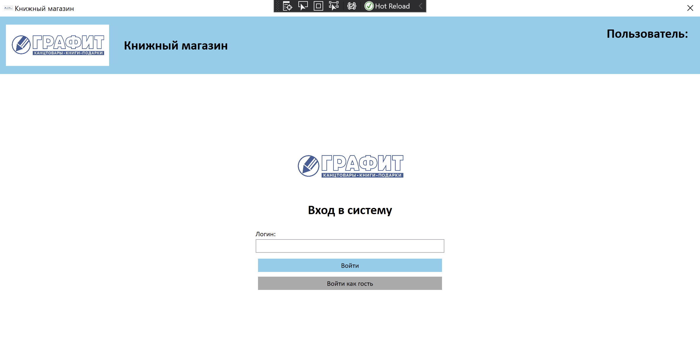
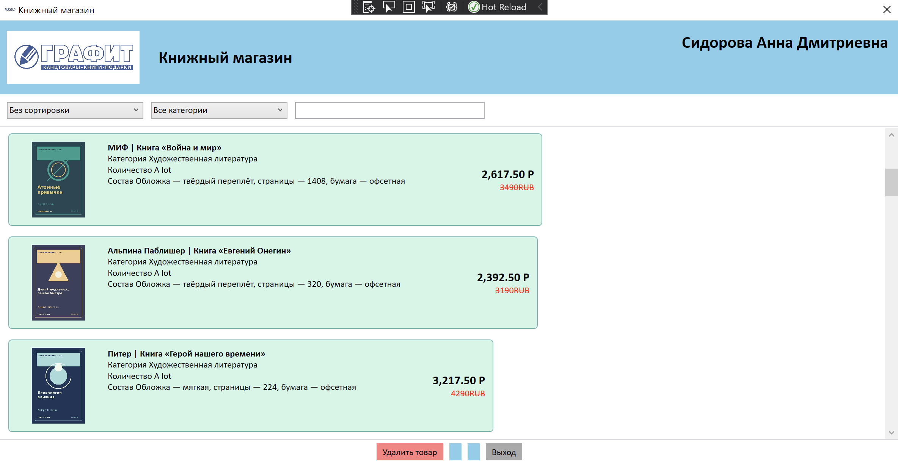
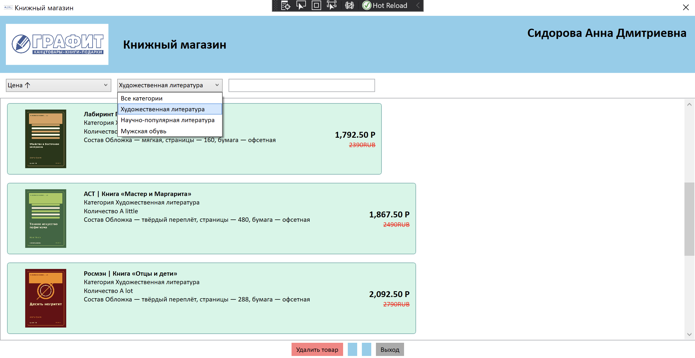
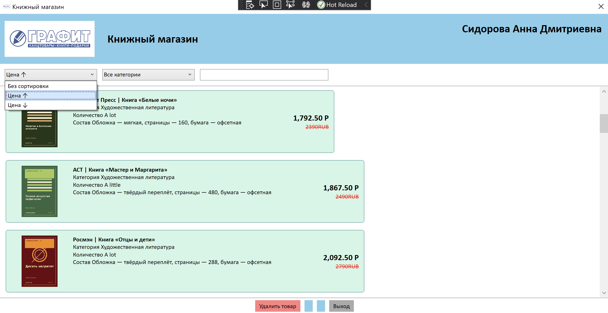

# WPF-приложение книжного магазина

Небольшой учебный проект на C# с базой данных SQL Server. Это настольное WPF-приложение для Windows. По заданию оно представляет книжный магазин: в приложении есть каталог книг, авторизация, поиск, фильтрация по категориям и сортировка по цене.

Изначально проект создавался для магазина обуви, но затем по заданию преподавателя был адаптирован под книжный магазин. Из-за ограниченного времени часть старых названий обувного проекта осталась в коде, именах файлов и объектах базы данных (например, `ShoeTest`). Это исторические названия; назначение проекта — книжный магазин.

## Среда разработки

Сервер базы данных запускался в Docker. Windows была запущена параллельно в Parallels Desktop; в ней были установлены Microsoft SQL Server Management Studio (SSMS) и Visual Studio. Разработка и запуск приложения выполнялись в этой среде Windows.

Чтобы подготовить базу данных, откройте скрипты из `database/` в SSMS и выполните их по порядку:

1. `script.sql` — создаёт базу `ShoeTest`, таблицы и связи между ними.
2. `ShoeTest_insert.sql` — добавляет в таблицы демонстрационные данные.

Перед запуском приложения проверьте строку подключения `ShoeTestEntities` в `WpfApp1/App.config` и замените адрес SQL Server и учётные данные на свои.

## Структура проекта

- `database/` — скрипты создания базы SQL Server и заполнения её примерами данных.
- `WpfApp1/` — исходный код WPF-приложения: экраны XAML, код на C#, модели Entity Framework и изображения товаров.
- `WpfApp1.sln` — решение Visual Studio.
- `docs/images/` — скриншоты для документации и диаграмма базы данных.

## Скриншоты

### Авторизация

### Каталог товаров

### Поиск по названию

### Фильтрация по категории

### Сортировка по цене

## Диаграмма базы данных

